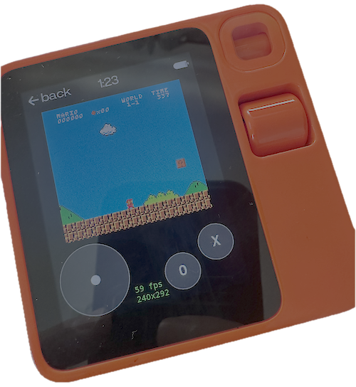
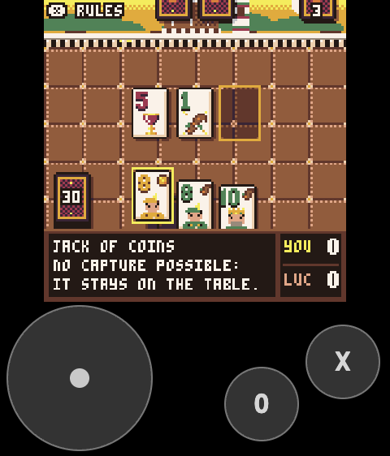
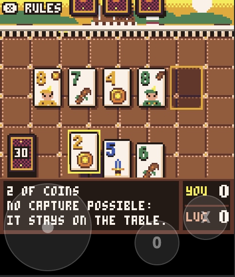
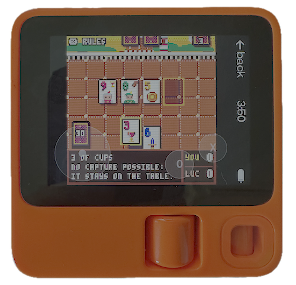

# pico8-r1

Package a PICO-8 cart as a Rabbit R1 Creation: a folder of static web files plus the install QR code.

<p align="center">
  
  <br />
  <sub>SMBP8 fan game on the Rabbit R1.</sub>
</p>


```
python3 pico8_to_r1.py cart.p8 --title "My Game" --base-url https://example.com/games/mygame/
```

The cart can be a `.p8` file or a `.p8.png` as distributed on the PICO-8 BBS (PICO-8 reads the PNG directly,
and the icon is cut from the cart's label).

Upload the contents of `dist/` to that URL (HTTPS), then scan `dist/qr.png` with the R1's Creations scanner.

As far as I know, it is not possible to side load the Creations, so it is required to upload the files to your web host,
and scan the QR code in the Creations app on the R1.

I did not try it, but I think it should be possible to host on your local machine, 
as long as the QR code point to the right URL, accessible by your R1.

## Installation

Requirements:

- **Python 3.8+**. The script itself uses only the standard library.
- **PICO-8 0.2.x**, your own licensed copy. The script looks for it in the usual install
  locations; otherwise pass `--pico8 /path/to/pico8` or set `PICO8`.
- **Pillow** and **qrcode** (optional): without them the script skips `icon.png` and `qr.png`.

```
python3 -m venv .venv
source .venv/bin/activate          # Windows: .venv\Scripts\activate
pip install pillow "qrcode[pil]"
```

Check that PICO-8 is found by running the packager on the included example:

```
python3 pico8_to_r1.py examples/btn_test.p8 --title "Button test" --base-url https://example.com/btntest/
```

The R1's scanner rejects a creation whose `description` is empty, so `--description` defaults to 
"`<title>` - PICO-8 game".

## Controls and Options

Controls on the R1: 
- touch d-pad and O/X buttons (multi-touch)
- scroll wheel = up/down, or left/right in landscape (`--invert-wheel` swaps)
- side button = O
- hold side button = pause menu

Options: 
- `--layout overlay` draws the controls over the game instead of in their own strip under it
(bigger game, but covered)

<table>
  <tr>
    <td></td>
    <td></td>
  </tr>
  <tr>
    <td align="center">Default</td>
    <td align="center">with: --layout overlay</td>
  </tr>
</table>

- `--orientation landscape` is for holding the R1 sideways with the wheel down: the page is rotated, the
d-pad goes in the bottom-left corner and O/X in the bottom-right, over a full-height game. If the picture
comes out upside down, add `--landscape-flip`.

<table>
	<tr>
		<td></td>
	</tr>
	<tr>
		<td align="center">with: --landscape --layout overlay</td>
	</tr>
</table>

- `--fps` shows a frame-rate and window-size readout.

### Extra files and info
`tools/probe.html` logs R1 events. 
`docs/r1-findings.md` records what was verified on a real R1.

## Links

### Where to get the PICO-8 fantasy console ?
- [PICO-8](https://www.lexaloffle.com/pico-8.php)

### Games featured in the screenshots

I featured 2 games in the screenshots:
- [Scopa! by Damobmafia](https://www.lexaloffle.com/bbs/?pid=197342#p)
- [SMBP8 by JadeLombax](https://www.lexaloffle.com/bbs/?pid=156989#p)

## License

QRBar is released under the MIT License. See [LICENSE](LICENSE) for details.